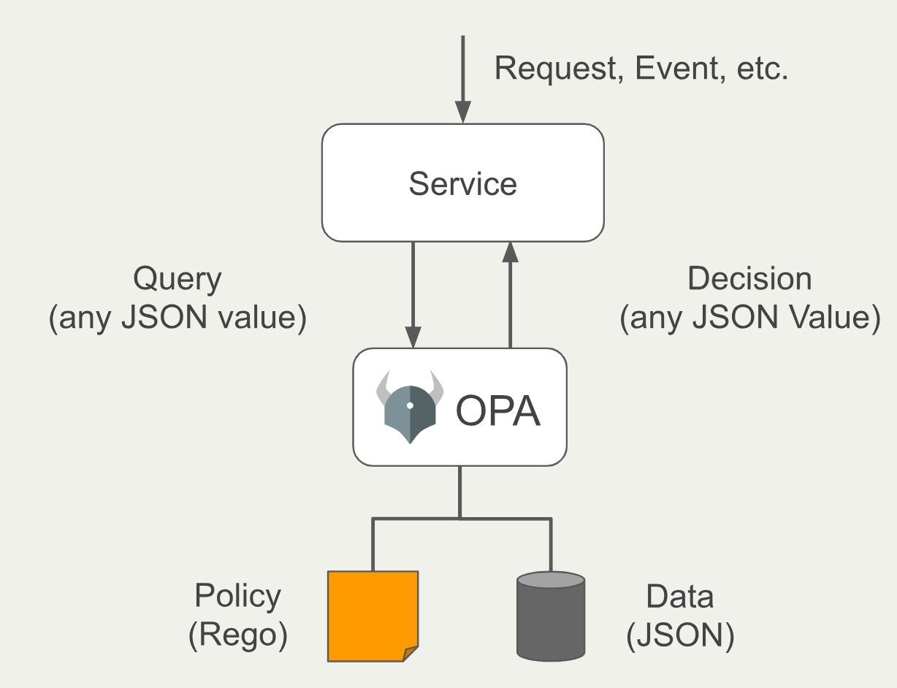
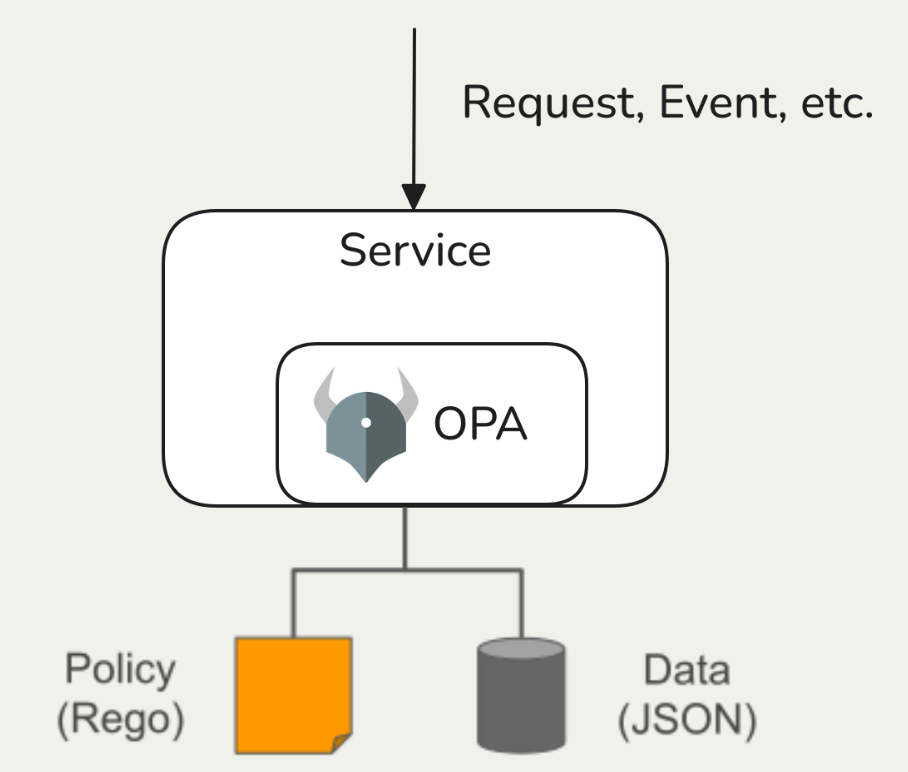

The Java SDK for running Wasm-compiled OPA policies now lives in the
[Open Policy Agent GitHub organization](https://github.com/open-policy-agent/opa-java-wasm).
It has new Maven coordinates, and [**opa-java-wasm 2.1.0**](https://central.sonatype.com/artifact/org.openpolicyagent/opa-java-wasm)
is available on Maven Central. This post covers what changed, how to upgrade, and why you might
want to evaluate Rego directly inside your JVM.

<!-- truncate -->

## What Changed

The project started at Styra, and it has now moved under the OPA umbrella together with a few other
community projects. It also switched to a new Wasm runtime along the way. Here is the full picture:

| | Before | Now |
|---|---|---|
| Repository | `github.com/StyraInc/opa-java-wasm` | `github.com/open-policy-agent/opa-java-wasm` |
| Maven coordinates | `com.styra.opa:opa-java-wasm` | `org.openpolicyagent:opa-java-wasm` |
| Java package | `com.styra.opa.wasm` | `org.openpolicyagent.wasm` |
| Wasm runtime | [Chicory](https://github.com/dylibso/chicory) | [Endive](https://endive.run/) |

**1.1.0 is the last release under `com.styra.opa`.** From 2.0.0 onwards, releases are published only as:

```xml
<dependency>
    <groupId>org.openpolicyagent</groupId>
    <artifactId>opa-java-wasm</artifactId>
    <version>2.1.0</version>
</dependency>
```

Upgrading is mechanical. Change the dependency, then replace `com.styra.opa.wasm` with
`org.openpolicyagent.wasm` in your imports. Apart from the rename, the API is the same.

Many thanks to Styra for incubating the project, and to the OPA maintainers for giving it a home.

## What It Is, and Why You'd Use It

OPA can compile Rego policies to WebAssembly with `opa build -t wasm`. opa-java-wasm loads the
resulting `policy.wasm` and evaluates it **inside your Java process**. Instead of asking an OPA
server for a decision over the network:



the policy is embedded in the service itself:



A few properties make this attractive on the JVM:

- **Pure Java.** The runtime is [Endive](https://endive.run/), a WebAssembly runtime written in Java
  and hosted by the Bytecode Alliance. There is no JNI and there are no native libraries to ship per
  platform. If a JVM 11+ runs there, your policies run there too.
- **Sandboxed.** The policy executes inside the Wasm sandbox. It can only reach the host through
  the small set of imports defined by
  [OPA's Wasm ABI](https://www.openpolicyagent.org/docs/wasm).
- **No extra moving parts.** Deploying the service is enough: there is no sidecar to deploy,
  monitor or scale alongside it.

This is not a replacement for running OPA as a server. The server, and clients like
[opa-java](https://github.com/open-policy-agent/opa-java), remain the right choice when you
want the full set of built-in functions, bundle management or decision logs out of the box. The
embedded SDK is aimed at hot paths, where a policy decision sits on every request or event and the
policy is self-contained.

Most built-ins are compiled straight into the Wasm module by OPA. The few that need help from the
host are provided by the SDK and you can register your own implementations as custom built-ins.

## Why It's Fast

- **Wasm becomes JVM bytecode.** When a policy is loaded, Endive's compiler translates the Wasm
  module into JVM bytecode. From then on the HotSpot JIT sees your policy as ordinary hot Java
  code, and it profiles, inlines and optimizes it like the rest of your application.
- **A decision is a method call.** There is no socket, HTTP request or connection pool between
  your code and the decision. The input JSON goes straight into the policy's linear memory.
- **Compile once, instantiate many (new in 2.1.0).** `OpaPolicyFactory` compiles the module once
  and creates isolated instances cheaply ([#218](https://github.com/open-policy-agent/opa-java-wasm/pull/218)).
- **Virtual-thread friendly.** `OpaPolicyPool` is lock-free internally, so borrowing a policy from a
  virtual thread doesn't pin its carrier thread.

## A One-Minute Demo

You need the [`opa` CLI](https://www.openpolicyagent.org/docs#1-download-opa) and
[JBang](https://www.jbang.dev/). Start with a small policy, `example.rego`:

```rego
package example

default allow := false

allow if input.role == "admin"

allow if {
    input.role == "viewer"
    input.method == "GET"
}
```

Compile it to Wasm, then extract the module from the bundle:

```shell
opa build -t wasm -e example/allow example.rego
tar -xzf bundle.tar.gz /policy.wasm
```

Save the following as `Demo.java`:

```java
//DEPS org.openpolicyagent:opa-java-wasm:2.1.0

import java.nio.file.Path;
import org.openpolicyagent.wasm.OpaPolicy;

class Demo {
    public static void main(String... args) {
        var policy = OpaPolicy.builder().withPolicy(Path.of("policy.wasm")).build();

        System.out.println(policy.evaluate("{\"role\": \"admin\", \"method\": \"DELETE\"}"));
        System.out.println(policy.evaluate("{\"role\": \"viewer\", \"method\": \"GET\"}"));
        System.out.println(policy.evaluate("{\"role\": \"viewer\", \"method\": \"DELETE\"}"));
    }
}
```

Run it:

```shell
$ jbang Demo.java
[{"result":true}]
[{"result":true}]
[{"result":false}]
```

That's all there is to it: no server and no network, with Rego evaluated inside the JVM.

For a concurrent service, combine the factory with the pool. Compilation happens once, and each
pooled instance gets its own isolated memory:

```java
var factory = OpaPolicyFactory.builder()
        .withPolicy(Files.readAllBytes(Path.of("policy.wasm")))
        .build(); // parse and compile once

var pool = OpaPolicyPool.create(factory::newPolicy, 4);

try (var loan = pool.borrow()) {
    String result = loan.policy()
            .data("{\"admins\": [\"alice\"]}")
            .input("{\"user\": \"alice\"}")
            .evaluate();
}
```

## Get Involved

- Code, docs and issues: [github.com/open-policy-agent/opa-java-wasm](https://github.com/open-policy-agent/opa-java-wasm)
- Questions about OPA and Rego: the [OPA Slack](https://slack.openpolicyagent.org)
- Questions about the Wasm runtime: the [Endive Zulip channel](https://bytecodealliance.zulipchat.com/#narrow/stream/endive)

If you're running OPA policies on the JVM, give 2.1.0 a try, and let us know how it goes.
